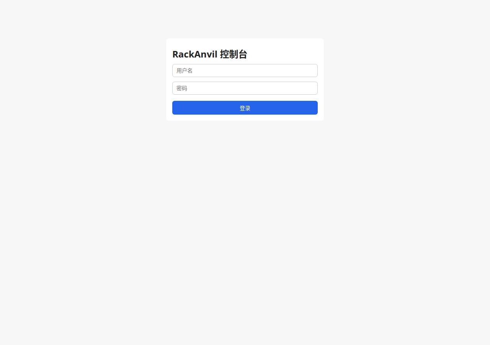
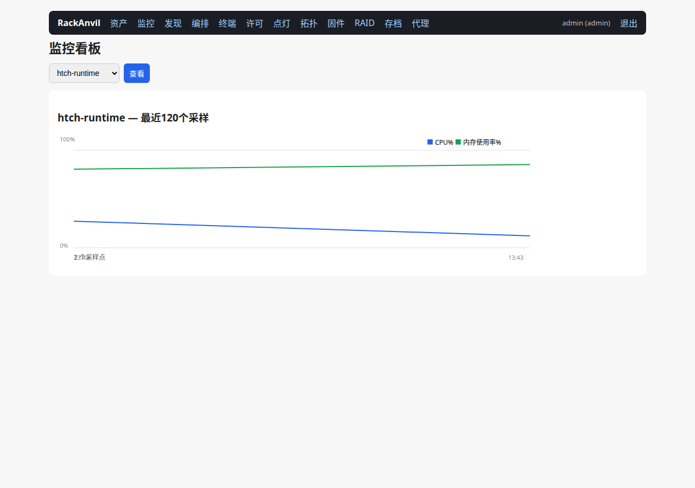
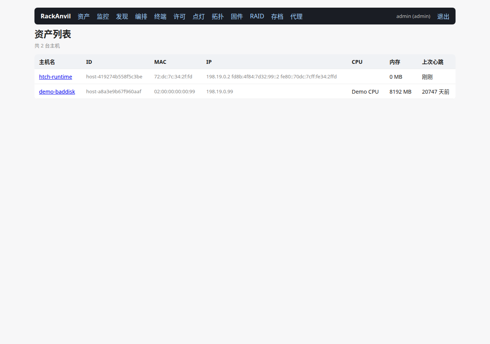
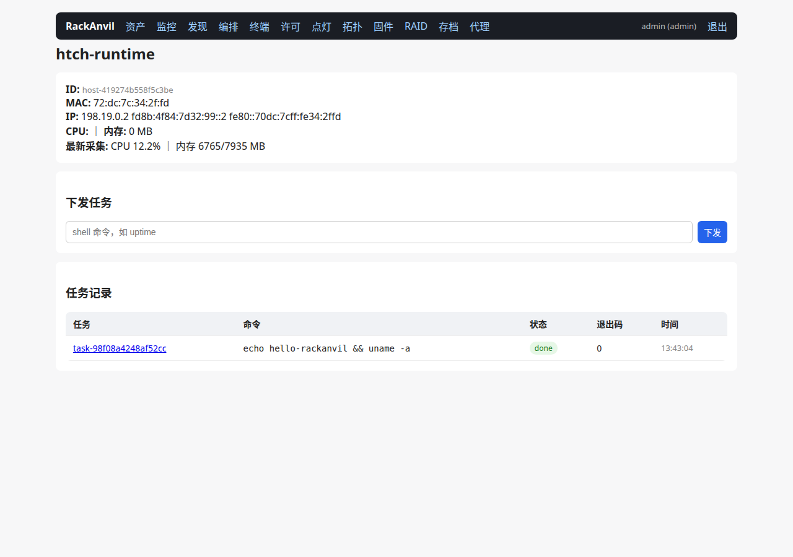
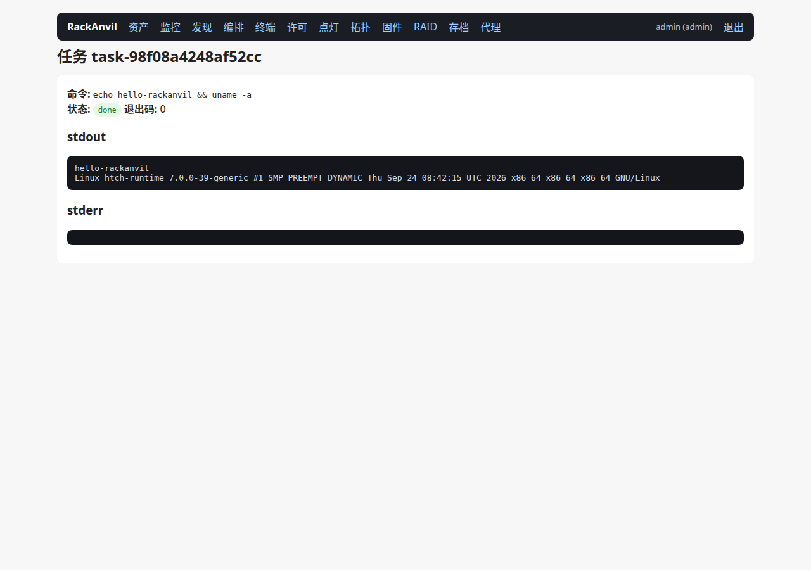
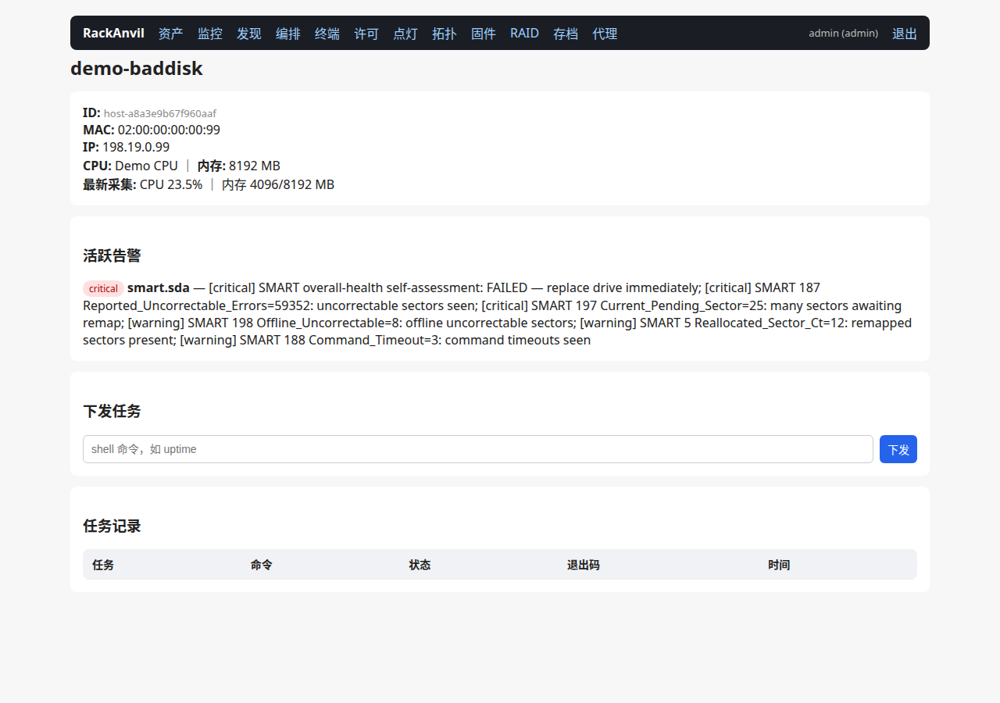
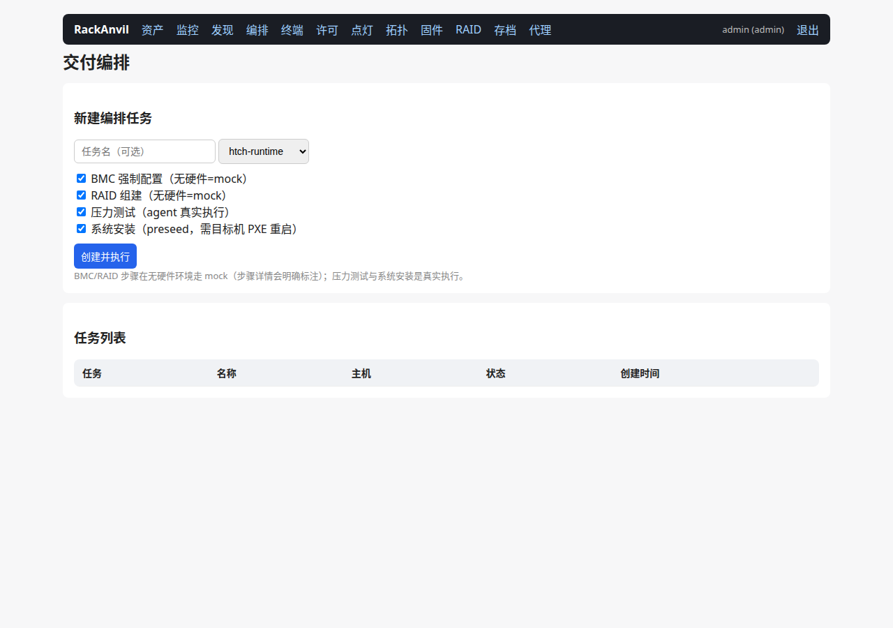
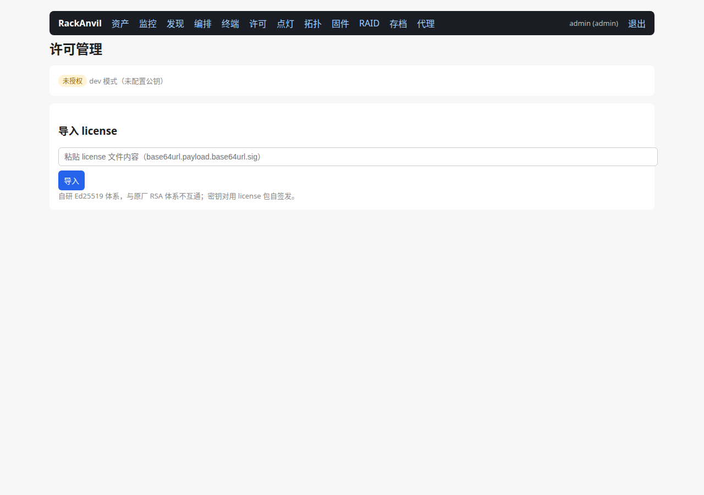

# RackAnvil 使用手册

版本：v1.0.0 ｜ 读者：第一次使用本系统的运维/实施人员，零基础可照做。

> 本手册所有界面截图均为**本产品自己的控制台**实际运行时的实拍（截图环境见每节说明），不含任何其他产品的图片。个别在控制台里没有对应页面的环节（如被管机器开机时的 PXE 画面），只用文字和结构图说明，并明确标注不是截图。

**几个词先说清（后文不再重复解释）：**

- **控制台**：用浏览器打开的管理网页，就是你操作这个系统的地方。
- **server**：管理端程序，一台机器上装一个，负责管所有机器。
- **agent**：装在每台被管机器上的小助手程序，负责报到、领任务、干活、回结果。
- **纳管**：把一台机器交给本系统管理。做法就是在那台机器上装好 agent 并让它向 server 报到。
- **任务**：你在控制台里下发给某台机器执行的一条命令，执行结果会回到控制台。
- **心跳**：agent 每隔一小段时间（默认 30 秒）向 server 报一声「我还活着」，顺带领走新任务。

---

## 1. 登录控制台

**前提**：server 已经部署并启动（部署方法见 `DEPLOY.md`）；你手里有管理员账号 `admin` 和首次启动时生成的随机密码（在 server 日志里，只出现一次）。

**步骤**

1. 打开浏览器，输入控制台地址：`http://<server 的 IP>:9100/`，例如 `http://192.168.1.10:9100/`。
2. 页面会自动跳到登录页。在 `用户名` 框输入 `admin`，在 `密码` 框输入随机密码。
3. 点 `登录` 按钮。



*图：登录页（本产品控制台实拍）*

**成功判定**：进入资产列表页，顶部有一条深色导航栏，写着 `资产`、`监控`、`发现` 等栏目，右上角显示 `admin (admin)` 和 `退出`。

**出错怎么办**

- 页面打不开：先确认地址和端口（默认 9100）没写错；再让部署同事确认 server 在运行、防火墙放行了 9100。
- 提示密码错误：随机密码区分大小写，照日志原文抄，别多抄空格。密码只在 server 第一次启动时打印过一次，找不到就看 `DEPLOY.md` 的故障排查表。

---

## 2. 看仪表盘（监控看板）

**前提**：已登录；至少有一台机器纳管并上报过指标（没有机器时看板是空的，属正常）。

**步骤**

1. 点顶部导航栏的 `监控`。
2. 在页面上方的下拉框里选一台主机，点 `查看`。
3. 下方卡片显示这台主机**最近 120 个采样**的 CPU / 内存曲线图（采样间隔就是 agent 的指标上报间隔，默认 60 秒一个点）。



*图：监控看板（本产品控制台实拍；曲线为本机 agent 真实上报数据）*

**成功判定**：能看到带曲线的卡片，标题是主机名 + `最近120个采样`。

**出错怎么办**

- 显示 `暂无采集数据（agent 上报后显示）`：这台机器的 agent 还没上报过指标。等 1–2 分钟刷新；一直没有就去那台机器上检查 agent 是否在运行（见第 3 节出错排查）。

---

## 3. 纳管一台机器（安装 agent）

**前提**：手里有发布包（`rackanvil_1.0.0_linux_<架构>.tar.gz`，架构要和被管机器一致）；被管机器能访问 server 的 9100 端口；有被管机器的 root 权限。

**步骤**（在被管机器上操作）

1. 把发布包拷到被管机器并解压：

   ```bash
   tar -xzf rackanvil_1.0.0_linux_amd64.tar.gz
   cd rackanvil_1.0.0_linux_amd64
   ```

2. 执行安装脚本（会装好 agent 程序和配置模板，重复执行也没关系）：

   ```bash
   sudo ./install.sh
   ```

3. 改 agent 配置，把 server 地址填对。用文本编辑器打开 `/etc/rackanvil/agent.env`，把这一行改成你的 server 地址：

   ```
   RACKANVIL_SERVER=http://192.168.1.10:9100
   ```

4. 启动 agent 并设为开机自启：

   ```bash
   sudo systemctl enable --now rackanvil-agent
   ```

5. 回到控制台，点顶部导航栏的 `资产`，看列表里有没有这台机器。



*图：资产列表（本产品控制台实拍；列表中的机器为真实报到的 agent）*

**成功判定**：资产列表里出现这台机器的主机名，`上次心跳` 显示 `刚刚` 或 `x 分钟前`。点主机名可以进详情页。

**出错怎么办**

- 列表里一直没有这台机器：在被管机器上按顺序查——
  1. `systemctl status rackanvil-agent` 看 agent 是否在运行；
  2. `curl http://<server IP>:9100/healthz` 看网络通不通（返回 `{"status":"ok",...}` 才是通）；
  3. `journalctl -u rackanvil-agent -n 30` 看日志报错，多半是 `RACKANVIL_SERVER` 地址写错。
- 没有 systemd 的机器：直接前台/后台运行 `/usr/lib/rackanvil/rackanvil-agent -server=http://<server IP>:9100` 也一样能纳管。

---

## 4. 下发第一个任务

**前提**：已登录（admin 账号有下发权限）；目标机器已纳管且心跳正常。

**步骤**

1. 点 `资产`，在列表里点目标机器的**主机名**，进入主机详情页。
2. 找到 `下发任务` 卡片，在输入框里填一条命令，例如 `uptime`（看机器开机多久、负载多少）。
3. 点 `下发` 按钮。



*图：主机详情页（本产品控制台实拍；中间就是 `下发任务` 卡片）*

4. 页面会自动跳到任务详情页。等几秒（agent 下一次心跳就会领走任务），刷新页面看结果。



*图：任务详情页（本产品控制台实拍；示例命令 `echo hello-rackanvil && uname -a` 的真实回传）*

**成功判定**：任务详情页 `状态` 是绿色的 `done`，`退出码` 是 `0`，`stdout` 区显示命令的真实输出。

**出错怎么办**

- 状态长时间停在 `pending`：目标机器的 agent 没在跑或心跳断了，回第 3 节排查。
- 状态是 `failed` 或退出码非 0：看同页的 `stderr` 区，是命令本身在目标机器上报错（如命令不存在），不是系统故障。
- 找不到 `下发任务` 卡片：你用的账号是只读角色（viewer）。v1.0.0 只有建号时的 admin 能下发，换 admin 登录。

---

## 5. 看磁盘健康与告警

**前提**：目标机器已纳管并上报过指标。磁盘健康数据来自 agent 采集的 SMART 信息（硬盘的自我健康报告）和 NVMe 健康数据；机器上没有 `smartctl` 工具或硬盘不支持时，这部分数据为空，属正常。

**步骤**

1. 点 `资产` → 点目标机器的主机名进详情页。
2. 看 `最新采集` 一行：CPU、内存的当前值。
3. 如果某块盘触发了健康规则（例如 SMART 关键属性超标、自检结论失败），详情页会出现红色的 `活跃告警` 卡片，逐条写明是哪类告警（`critical` 是严重、`warn` 是警告）和具体内容。
4. 想看趋势，回 `监控` 页看曲线的异常时段，再对照告警时间判断。



*图：主机详情页的活跃告警卡片（本产品控制台实拍；该主机的 SMART 数据触发了存储健康规则，告警由系统真实产生）*

**成功判定**：健康时详情页没有告警卡片；有问题时告警卡片逐条列出，处理完（换盘/恢复）后 agent 下一轮上报会自动把已恢复的告警转入历史，卡片消失。

**出错怎么办**

- 怀疑盘有问题但没告警：先确认这台机器装了 `smartctl`（`which smartctl`），没装时 agent 采不到 SMART；装上后等一轮上报再看。
- 告警一直不消失：说明指标还没恢复到正常范围，告警是实时状态，不是通知记录，不需要手工确认关闭。

---

## 6. 跑一次装机（PXE 流程说明）

PXE 装机是给**还没有系统的裸机**（或需要重装的机器）用的：机器一开机从网卡启动，通过网络从 server 拉走安装程序，全自动装完系统并装好 agent，装完自动回到资产列表。

**控制台里没有 PXE 画面可截**：开机阶段的画面出现在被管机器自己的屏幕上，不属于本产品控制台。下面用文字结构图说明流程（**这是流程说明图，不是截图**）：

```
被管机器开机（BIOS/UEFI 里选网卡启动）
   │ 1. 向网络要地址（DHCP；用 server 内置 DHCP 或现有 DHCP + 旁路模式）
   ▼
拿到地址 + 引导文件位置
   │ 2. 从 server(9100) 下载引导脚本，脚本再拉 Debian 内核与 initrd
   ▼
安装程序启动，按 preseed 配置全自动分区、装系统
   │ 3. 装完前最后一步：从 server 下载 agent、装成系统服务、
   │    回报 server「装机完成」，然后按脚本重启
   ▼
新系统启动，agent 自动报到 → 资产列表出现这台机器（装机闭环完成）
```

**前提**：server 侧已按 `DEPLOY.md` 配好——`RACKANVIL_PUBLIC_URL` 是被管网段可达的地址、`RACKANVIL_AGENT_BIN` 已指向 agent 二进制；网络里 DHCP 的分工已定（server 内置 DHCP，或现有 DHCP + ProxyDHCP 旁路，二选一，不能两个 DHCP 同时发地址）。

**步骤（控制台侧）**

1. 先让目标机器在控制台里「布防」为待装机：通过 `编排` 页新建编排任务时勾选 `系统安装（preseed，需目标机 PXE 重启）` 步骤，或按部署文档用 API 布防。这一步是告诉 server：「这台机器下次来拉引导脚本时，给它安装模式」。
2. 让目标机器从网卡启动（开机时按厂商热键选 PXE/网络启动，或在 BMC 里设一次性网络启动）。
3. 剩下的全自动：等装机完成（时间取决于磁盘和镜像源速度），机器重启后回控制台 `资产` 列表确认它以新系统报到。



*图：编排页（本产品控制台实拍；`系统安装` 是其中一个步骤，与压测等步骤组合成一次交付）*

**成功判定**：资产列表里这台机器重新出现且心跳正常；编排任务详情里 `系统安装` 步骤为 `done`。

**出错怎么办**

- 机器开机没走网络启动：检查 BIOS/UEFI 启动顺序与网卡 ROM 开关。
- 引导脚本拉到了但装机中断：多半是镜像源到不了（内网环境把 `RACKANVIL_MIRROR_HOST` 指向本地镜像）或 `RACKANVIL_PUBLIC_URL` 不可达；开 server 的 `RACKANVIL_LOG_REQUESTS=true` 看请求日志定位断在哪一步。
- 装完但没回资产列表：agent 下载或安装那一步失败，查 server 日志里该机器的 `install-done` 记录有没有出现。

---

## 7. 用户与授权管理

### 7.1 用户（如实说明当前版本能力）

v1.0.0 的用户体系现状，请先知道再操作：

- 系统里只有首次启动时自动创建的管理员 `admin` 一个账号（密码为随机生成、日志打印一次的那串）。
- 服务端有三档角色并实际生效：`admin`（全权）、`operator`（可下发任务）、`viewer`（只读）。
- **但 v1.0.0 的控制台还没有用户管理页面，也没有改密码入口**——暂时无法在界面里新增用户或改密码。这是当前版本的明确缺口（见 `DEPLOY.md` §9），后续版本补齐。现阶段请把 admin 密码当作高敏感凭据保管（存密码管理器，不要写在共享文档里）。

### 7.2 授权（license）管理

**前提**：已登录 admin；手里有与本部署公钥配套的 license 文本（授权体系是产品自研的 Ed25519 方案，导入入口在控制台的 `许可` 页）。

**步骤**

1. 点顶部导航栏的 `许可`。
2. 页面上方卡片显示当前授权状态：`未授权` 时会注明当前模式（如开发模式）；已授权时显示客户名、最大主机数和到期时间。
3. 在 `导入 license` 卡片的输入框里粘贴完整的 license 文本，点 `导入`。



*图：许可页（本产品控制台实拍；未配置公钥时为开发模式，页面如实显示状态）*

**成功判定**：导入后刷新页面，状态卡片变为 `已授权` 并显示客户与到期信息。

**出错怎么办**

- 导入报错：license 与部署时配置的公钥不是一对，或文本粘贴不完整（要整段复制）。开发/试用环境可以不配公钥，系统按开发模式运行，`许可` 页会如实显示 `未授权` 及原因，不影响其他功能使用。

---

## 8. 备份与恢复

控制台里没有备份页面，这一步在 server 的命令行做（脚本随发布包装好，装在 `/usr/lib/rackanvil/`）。

**前提**：能登录 server 主机；知道当前用的数据库模式（看 `/etc/rackanvil/server.env` 里的 `RACKANVIL_DB`）。

### 8.1 备份

1. 先停服（保证数据库文件拷的是静止状态）：

   ```bash
   sudo systemctl stop rackanvil-server
   ```

2. 执行备份脚本（参数依次是：数据库 DSN、资产目录、备份输出目录）：

   ```bash
   /usr/lib/rackanvil/backup.sh "sqlite:/var/lib/rackanvil/rackanvil.db" \
     /usr/share/rackanvil/assets /var/backups/rackanvil
   ```

   PostgreSQL 模式把第一个参数换成你的 `postgres://...` DSN（需要 server 主机装有 `pg_dump`）。

3. 看到输出 `PASS`，并在输出目录生成 `rackanvil-backup-<时间>.tar.gz`，就是备份成功。
4. 重新起服：`sudo systemctl start rackanvil-server`。把备份包另存一份到别的机器，别只放本机。

### 8.2 恢复（含先演练再真恢复）

1. **先演练验证**（不碰线上数据）：

   ```bash
   /usr/lib/rackanvil/restore.sh /var/backups/rackanvil/rackanvil-backup-<时间>.tar.gz /tmp/restore-check
   ```

   输出 `PASS: backup archive verified` 且能读出主机数，说明这个备份包是好的。

2. **真恢复**：停服 → 把备份包解压 → 将其中的 `rackanvil.db` 放回 `/var/lib/rackanvil/`（属主改回 `rackanvil`：`chown rackanvil:rackanvil /var/lib/rackanvil/rackanvil.db`），资产目录覆盖回 `/usr/share/rackanvil/assets` → 起服。
3. 登录控制台核对：资产数量、任务记录与备份时点一致即恢复成功。

**出错怎么办**

- 演练报 `FAIL`：备份包损坏或不完整，别拿它做真恢复，换一份更早的备份重演练。
- 恢复后 server 起不来：看 `journalctl -u rackanvil-server`，多半是库文件属主/权限不对（应为 `rackanvil` 可读写）。
